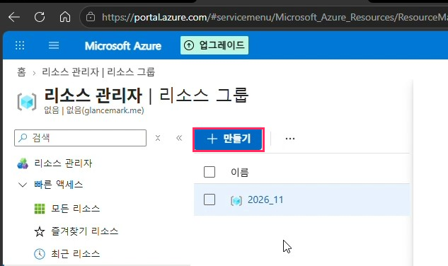
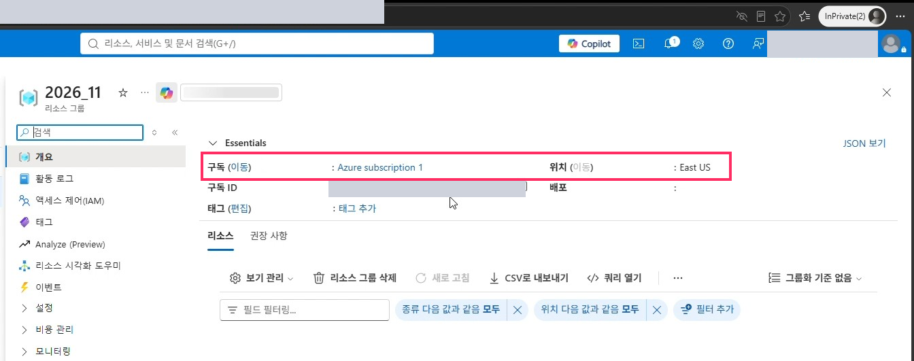

# 01. Azure 리소스 생성

> Copilot Credit 요금이 청구될 Azure 구독과 리소스 그룹을 먼저 만듭니다.

## 따라하기

1. **Azure Portal 접속**
   [portal.azure.com](https://portal.azure.com)에 업무(관리자) 계정으로 로그인합니다.
2. **리소스 그룹 메뉴 열기**
   상단 검색창에 `리소스 그룹`을 입력하거나 `리소스 관리자 > 리소스 그룹`으로 이동합니다.
3. **[+ 만들기] 클릭** 후 아래 값을 입력합니다.

   | 항목 | 입력 예시 |
   |---|---|
   | 구독 | Azure subscription 1 |
   | 리소스 그룹 이름 | `2026_11` |
   | 지역 | East US |

   

4. **[검토 + 만들기] → [만들기]**
   유효성 검사가 통과되면 생성이 완료됩니다.
5. **생성 결과 확인**
   리소스 그룹 개요에서 구독과 위치를 확인합니다.

   

## TIP

- 이 리소스 그룹은 [03. Copilot Credit 설정](03-copilot-credit-billing.md)의 청구 플랜에서 선택합니다.
- 결제 수단이 등록된 Azure 구독이 있어야 합니다.

---
[← README](../README.md) · [다음: 02. Power Platform 환경 생성 →](02-power-platform-environment.md)
