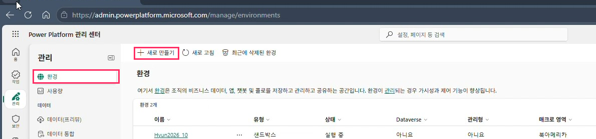
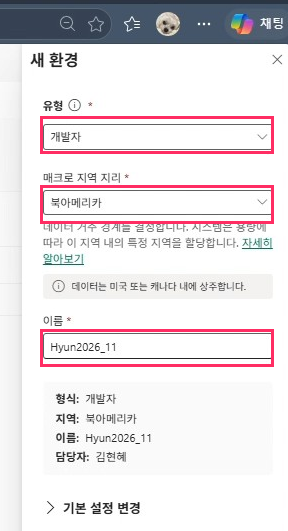
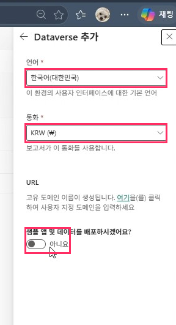
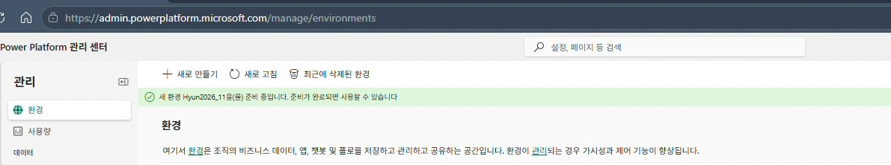

# 02. Power Platform 관리 센터: 환경 생성

> 에이전트를 만들고 저장할 전용 환경(Dataverse 포함)을 만듭니다.

## 따라하기

1. **관리 > 환경 이동**
   [admin.powerplatform.microsoft.com](https://admin.powerplatform.microsoft.com) 접속 후 왼쪽 `관리` > `환경`을 선택합니다.
2. **[+ 새로 만들기] 클릭**

   

3. **새 환경 정보 입력** → **[다음]**

   | 항목 | 값 |
   |---|---|
   | 유형 | 개발자 |
   | 매크로 지역 | 북아메리카 |
   | 이름 | 예) `Hyun2026_11` |

4. **Dataverse 추가** → **[저장]**

   | 항목 | 값 |
   |---|---|
   | 언어 | 한국어(대한민국) |
   | 통화 | KRW(₩) |
   | 샘플 앱 및 데이터 배포 | 아니요 |

    

5. **생성 확인**
   상단에 `새 환경 … 준비 중` 알림이 표시되고, 몇 분 뒤 목록에서 사용할 수 있습니다.

   

## TIP

- 환경 이름에 연도·월을 붙이면 나중에 [정리(삭제)](10-cleanup.md)할 때 찾기 쉽습니다.

---
[← 01. Azure 리소스 생성](01-azure-resource.md) · [다음: 03. Copilot Credit 설정 →](03-copilot-credit-billing.md)
