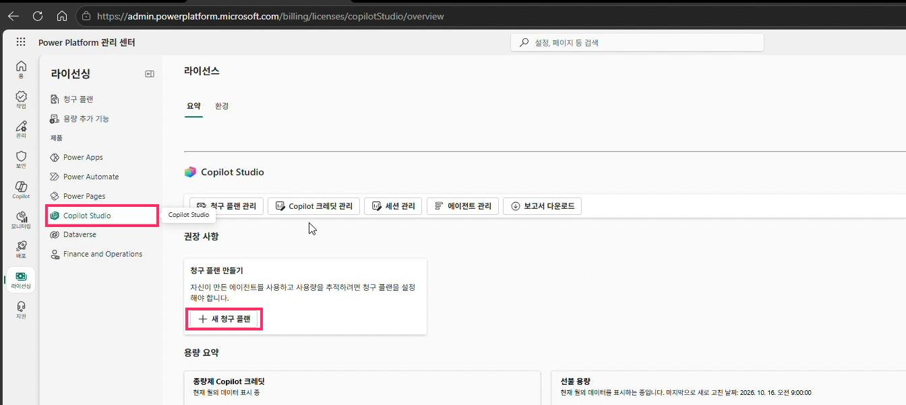
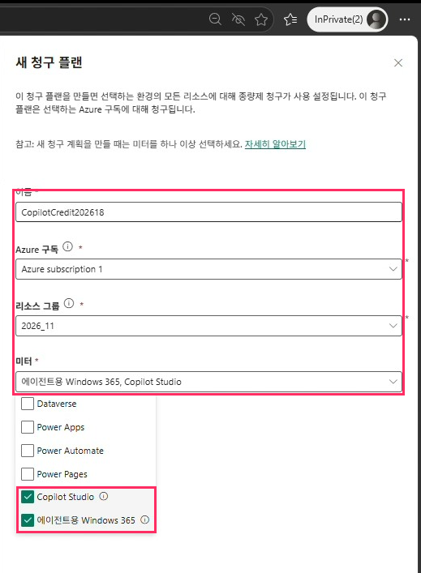
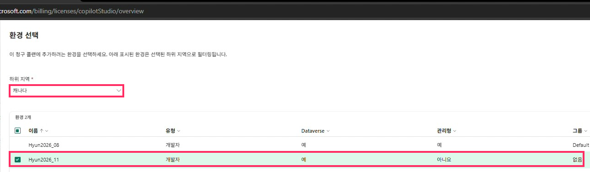

# 03. Power Platform 관리 센터 라이선싱: Copilot Credit 설정

> 청구 플랜으로 Azure 구독과 환경을 연결해 Copilot Credit을 종량제로 사용합니다.

## 따라하기

1. **라이선싱 > Copilot Studio**
   관리 센터 왼쪽 `라이선싱` → 제품 `Copilot Studio`를 선택합니다.
2. **[+ 새 청구 플랜] 클릭**
   권장 사항의 `청구 플랜 만들기` 카드에 있습니다.

   

3. **청구 플랜 정보 입력** → **[다음]**

   | 항목 | 값 |
   |---|---|
   | 이름 | 예) `CopilotCredit202618` |
   | Azure 구독 | Azure subscription 1 |
   | 리소스 그룹 | [01단계](01-azure-resource.md)에서 만든 `2026_11` |
   | 미터 | **Copilot Studio** (필요 시 에이전트용 Windows 365) |

   

4. **환경 선택** → **[저장]**
   하위 지역(예: 캐나다)을 고르면 해당 지역 환경이 표시됩니다. [02단계](02-power-platform-environment.md)에서 만든 환경을 체크합니다.

   

5. **연결 확인**
   요약 화면의 `청구 플랜` 수가 1로 표시되면 완료입니다.

## 비용 관리 포인트

- Copilot Credit은 사용한 만큼 Azure 구독으로 청구됩니다.
- 청구 플랜을 만들면 Azure 리소스 그룹 안에 `CopilotCredit…` 리소스가 함께 생깁니다.
- 실습 후에는 [10. 정리](10-cleanup.md)에서 리소스 그룹을 삭제해 과금을 멈추세요.

---
[← 02. Power Platform 환경 생성](02-power-platform-environment.md) · [다음: 04. SharePoint 사이트 생성 →](04-sharepoint-site.md)
