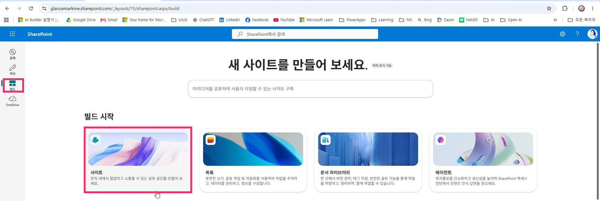
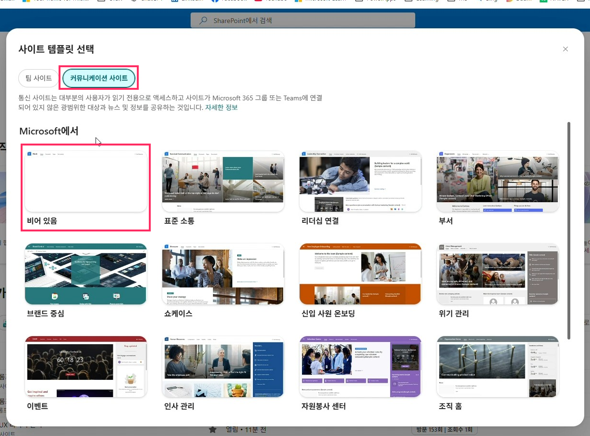
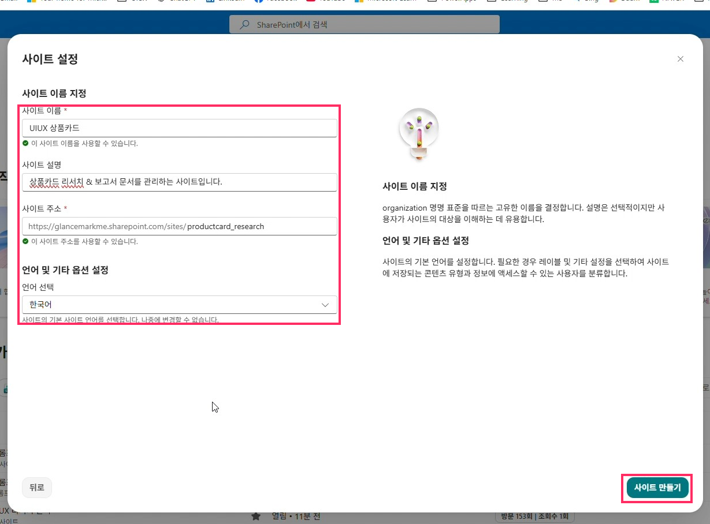
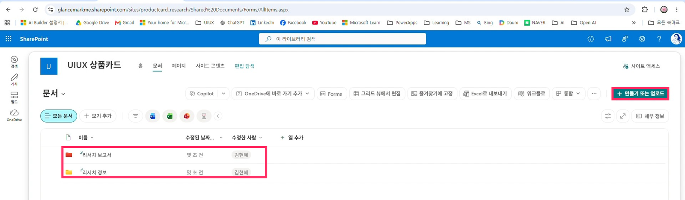

# 04. SharePoint 사이트 생성: UIUX 리서치 관리

> 리서치 정보(Word)와 리서치 보고서(PPT)를 모아 둘 사이트와 폴더를 만듭니다.

## 따라하기

1. **[빌드] > 사이트**
   SharePoint 홈 왼쪽 `빌드` → `새 사이트를 만들어 보세요` 화면의 빌드 시작에서 `사이트`를 선택합니다.

   

2. **템플릿 선택**
   `커뮤니케이션 사이트` 탭 > `비어 있음` → **[템플릿 사용]**

   

3. **사이트 설정 입력** → **[사이트 만들기]**

   | 항목 | 입력 예시 |
   |---|---|
   | 사이트 이름 | `UIUX 리서치 관리` |
   | 사이트 설명 | 상품카드 리서치 & 보고서 문서를 관리하는 사이트입니다. |
   | 사이트 주소 | 영문 (예: `productcard_research`) |
   | 언어 | 한국어 |

   

4. **[사이트로 이동]**
   `사이트가 준비되었습니다!` 화면에서 이동합니다.
5. **폴더 2개 만들기**
   `문서` > **[+ 만들기 또는 업로드]** > `폴더`로 아래 두 폴더를 만듭니다.
   - `리서치 정보` (Aside가 작성한 Word 리서치 정보)
   - `리서치 보고서` (에이전트가 작성한 PPT 보고서)

   

6. **(선택) 구성원 추가**
   함께 쓸 계정을 사이트 구성원으로 추가합니다. ([08. Claude 프로젝트](08-reference-claude.md) 연동 시 필요)

## 폴더 구조

```
UIUX 리서치 관리 (사이트)
└── 문서
    ├── 리서치 정보     ← Word: <YYYYMMDD>_UIUX 리서치_상품카드_<경쟁사>_<상품>_v<버전>.docx
    └── 리서치 보고서   ← PPT : UIUX Research_<리서치명>_<YYYYMMDD>_v<버전>.pptx
```

---
[← 03. Copilot Credit 설정](03-copilot-credit-billing.md) · [다음: 05. Copilot Studio 환경 설정 →](05-copilot-studio-environment.md)
