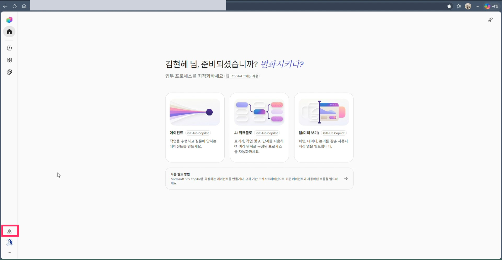
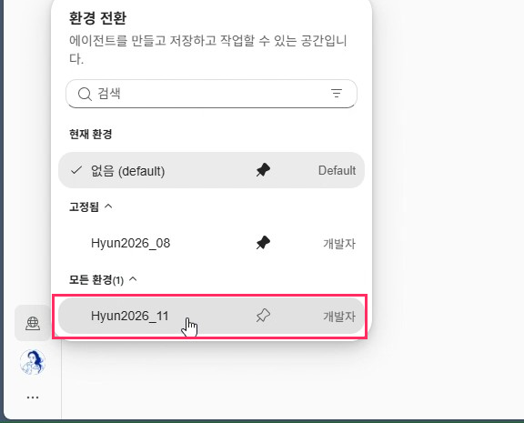

# 05. Copilot Studio 환경 설정

> [02단계](02-power-platform-environment.md)에서 만들고 [03단계](03-copilot-credit-billing.md)에서 Copilot Credit을 연결한 환경으로 전환합니다.

## 따라하기

1. **Copilot Studio 접속**
   [copilotstudio.microsoft.com](https://copilotstudio.microsoft.com)에 같은 업무 계정으로 접속합니다.
2. **환경 아이콘 클릭**
   왼쪽 아래 지구본 아이콘을 누르면 `환경 전환` 패널이 열립니다.

   

3. **`모든 환경` 펼치기**
   목록에서 02단계에서 만든 환경을 찾습니다.
4. **환경 선택**
   예) `Hyun2026_11` 클릭. 자주 쓰는 환경은 핀으로 고정해 두면 편합니다.

   

5. **연결 확인**
   03단계 청구 플랜에 추가한 환경과 같은 환경인지 확인합니다.

## 한 번에 정리

```
Azure 리소스 그룹(01) → 청구 플랜(03) ← 환경(02) → Copilot Studio에서 같은 환경 선택(05)
```

- 이 연결이 맞아야 에이전트 사용량이 청구 플랜(Copilot Credit)으로 집계됩니다.
- 처음에는 기본(default) 환경이 선택되어 있으니, 반드시 만든 환경으로 바꾼 뒤 에이전트를 만드세요.

---
[← 04. SharePoint 사이트 생성](04-sharepoint-site.md) · [다음: 06. 에이전트 만들기 →](06-create-agent.md)
