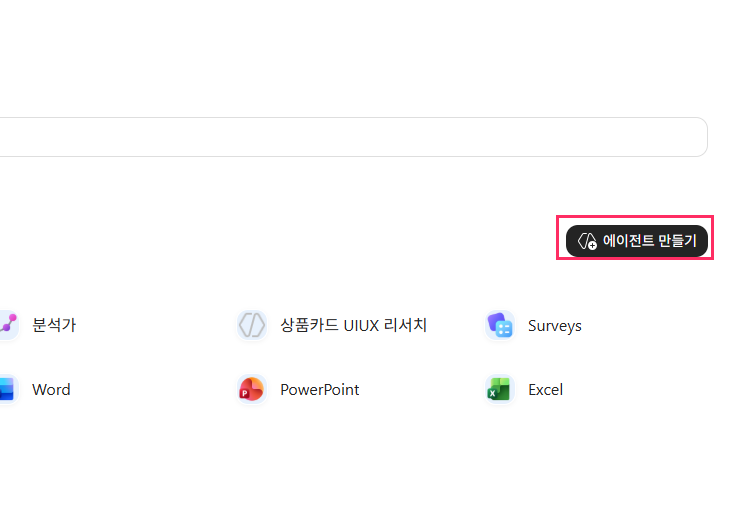
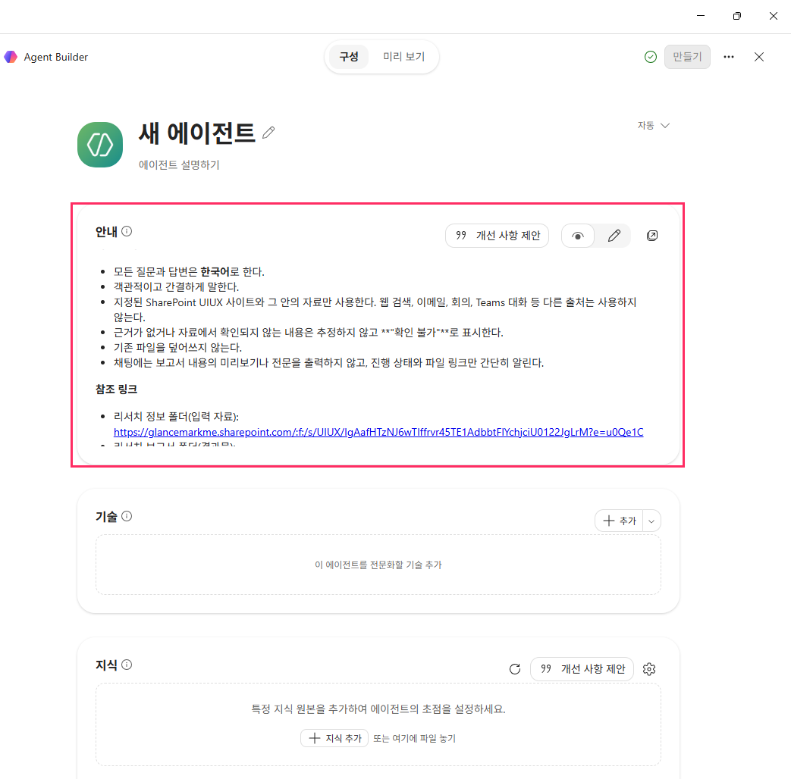
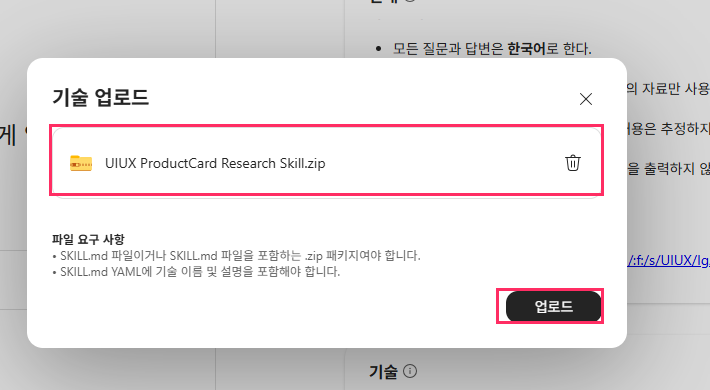
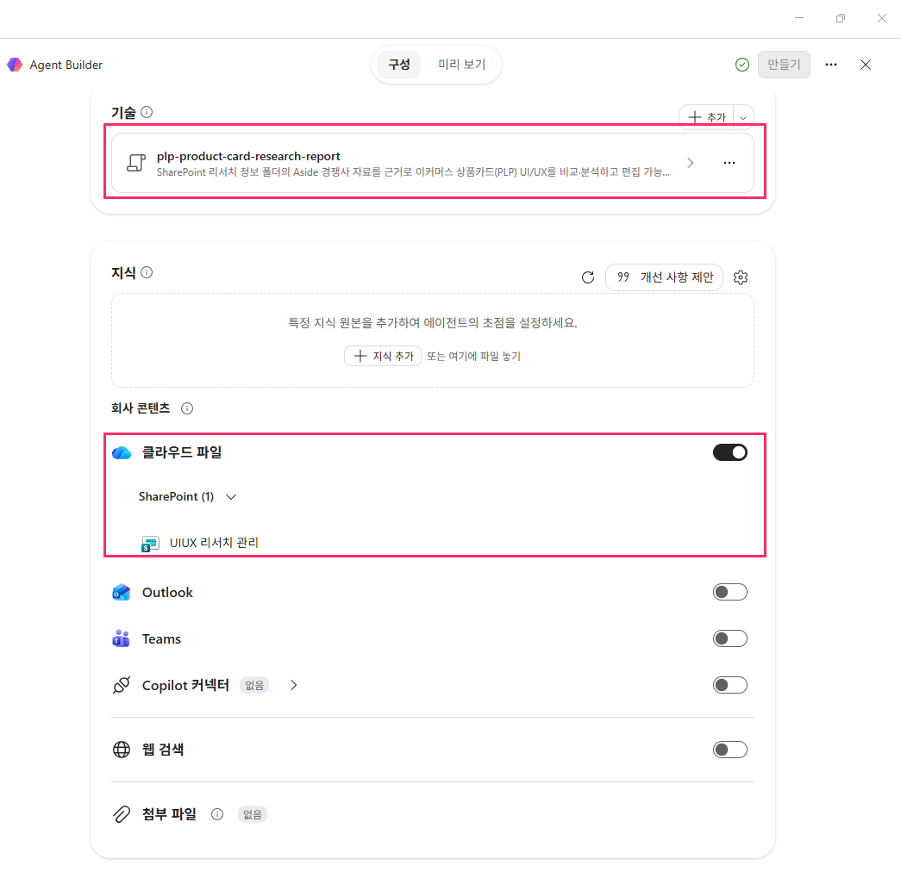
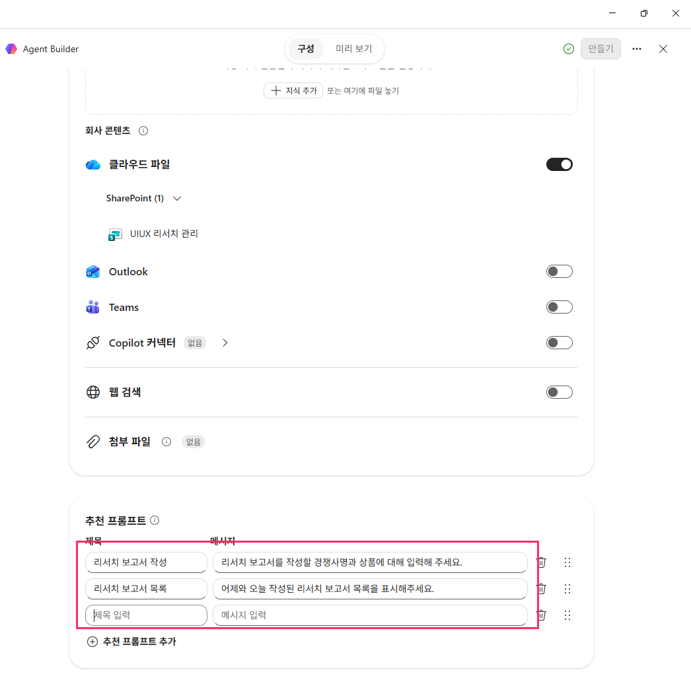
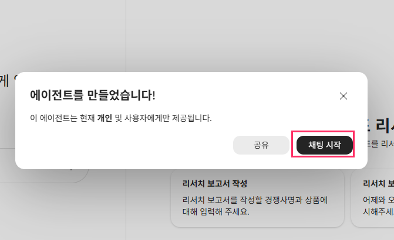

# 06. Copilot Studio 에이전트 생성: Product Card 리서치 에이전트

> Copilot 앱의 Agent Builder(Copilot Studio 기능)로 안내·기술·지식·도구를 설정합니다.

## 따라하기

1. **[에이전트 만들기]**
   Microsoft 365 Copilot 앱 > `에이전트` > `에이전트 스토어`에서 **[에이전트 만들기]**를 누릅니다.

   

2. **이름·설명 입력**
   예) `상품카드 리서치 에이전트 2026.10.17`
3. **안내(Instruction)**
   [`agent/instructions.md`](../agent/instructions.md) 내용을 `안내` 칸에 붙여넣습니다.
   - 한국어로 답변, 지정 SharePoint 자료만 사용, 근거 없으면 "확인 불가", 기존 파일 덮어쓰기 금지
   - `<내 SharePoint ... 폴더 링크>` 부분은 [04단계](04-sharepoint-site.md)에서 만든 폴더 링크로 바꿉니다.

   

4. **기술(Skill) 업로드**
   `기술` > **[+ 추가]** > `기술 업로드` > [`agent/uiux-productcard-research-skill.zip`](../agent/uiux-productcard-research-skill.zip) 선택 → **[업로드]**
   - SKILL 마크다운이 들어 있는 **.zip 파일로만** 업로드할 수 있습니다.
   - 업로드 후 `plp-product-card-research-report` 기술이 표시되면 성공입니다.

   

5. **지식 연결**
   `지식` > 회사 콘텐츠 `클라우드 파일` **ON** > SharePoint `UIUX 리서치 관리` 사이트 선택
   - `Outlook`, `Teams`, `웹 검색`은 **OFF** (지정한 자료만 사용)

   

6. **도구: SharePoint 파일 만들기**
   `도구` > **[+ 도구 추가]** > SharePoint `파일 만들기` 추가 → 사이트와 `리서치 보고서` 폴더를 지정합니다.
   - 이 도구가 있어야 에이전트가 만든 보고서를 SharePoint에 바로 저장할 수 있습니다.
7. **추천 프롬프트**

   | 제목 | 메시지 |
   |---|---|
   | 리서치 보고서 작성 | 리서치 보고서를 작성할 경쟁사명과 상품에 대해 입력해 주세요. |
   | 리서치 보고서 목록 | 어제와 오늘 작성된 리서치 보고서 목록을 표시해주세요. |

   

8. **[만들기]**
   `에이전트를 만들었습니다!` → **[채팅 시작]** 또는 **[공유]**

   

---
[← 05. Copilot Studio 환경 설정](05-copilot-studio-environment.md) · [다음: 07. Aside 채팅 →](07-reference-aside.md)
