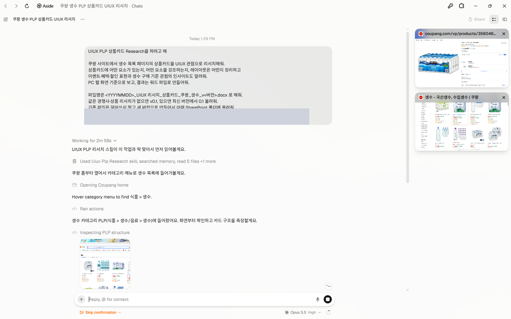
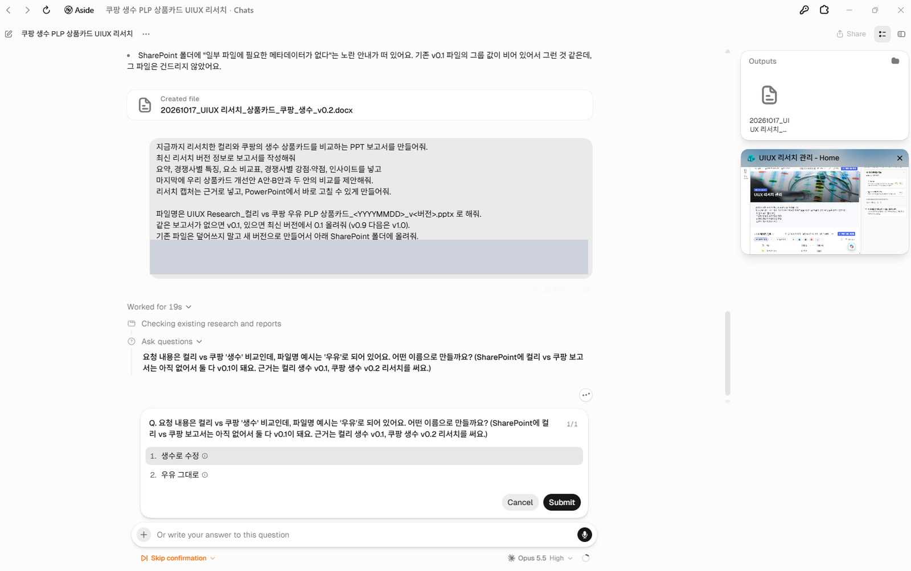
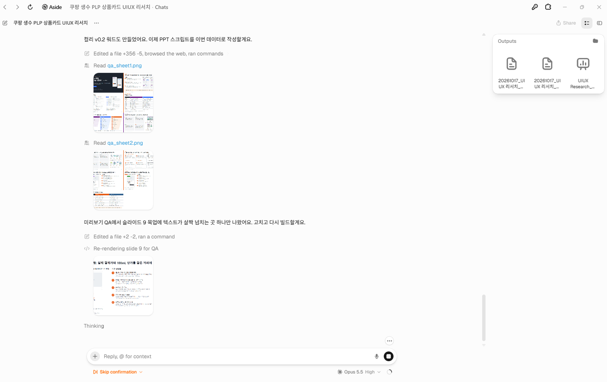

# 07. 참고 자료: Aside 채팅

> Aside 채팅에서 리서치 정보(Word)와 리서치 보고서(PPT)를 바로 작업하는 방법입니다.

**준비:** Claude 구독 · SharePoint 접근 허가

## 프롬프트

- ① [리서치 정보 작성 프롬프트](../prompts/01-research-info.md): 경쟁사 PLP 상품카드를 리서치해 Word로 저장
- ② [리서치 보고서 작성 프롬프트](../prompts/02-research-report.md): 리서치한 경쟁사를 비교하는 PPT 보고서 작성

## 실행 화면

| 사이트를 직접 열어 상품카드를 리서치 | 파일명이 요청과 다르면 정정 질문 |
|---|---|
|  |  |

## 써 보니 좋았던 점

- 요청 상품과 파일명이 다르면 먼저 확인 질문을 합니다. (예: 생수 vs 우유)
- SharePoint의 최신 리서치 정보 파일(버전)을 찾아 보고서에 활용합니다.
- 결과물을 스스로 미리보기·검수하고 고칩니다. (평가 기능)

## 주의

- `리서치 정보 폴더 안의 정보로만 작성`을 명시하지 않으면 리서치를 다시(v0.2) 하는 불필요한 작업이 생길 수 있습니다.
- Aside를 쓸 때는 SharePoint와 로컬 파일이 동기화(Sync)되어 있어야 합니다.

---
[← 06. 에이전트 만들기](06-create-agent.md) · [다음: 08. Claude 프로젝트 →](08-reference-claude.md)
