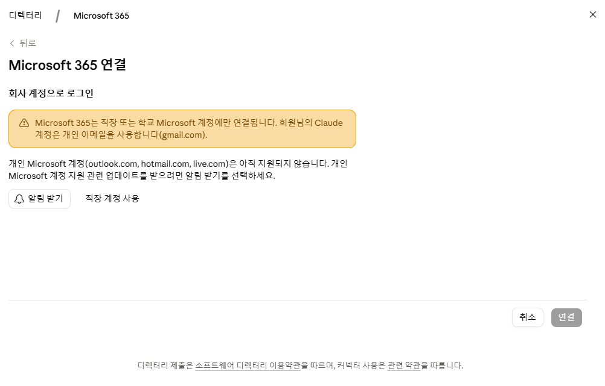
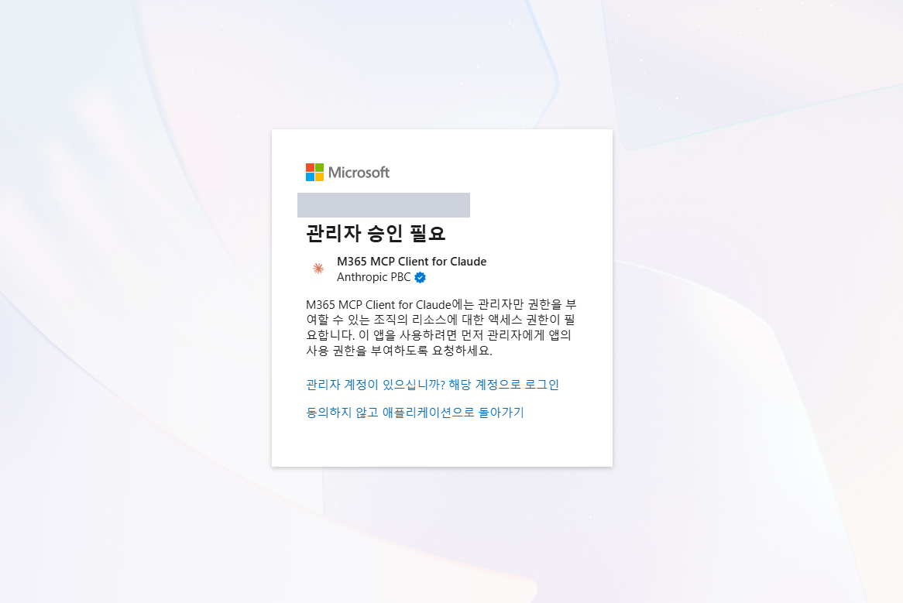
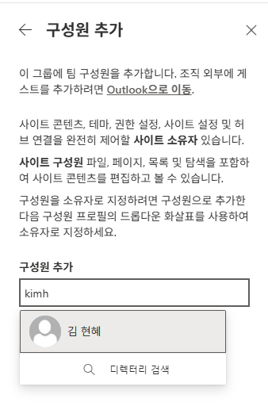
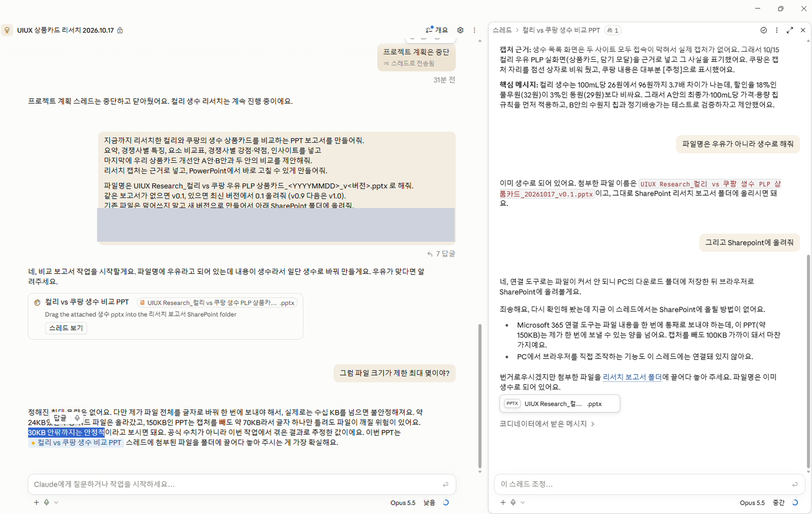

# 08. 참고 자료: Claude 프로젝트

> Claude 프로젝트에 SharePoint를 연결해 리서치 정보·보고서를 작업하는 방법입니다.

## 따라하기

1. **프로젝트 생성**
   Claude에서 새 프로젝트를 만듭니다.
2. **Microsoft 365 커넥터 연결**
   커넥터 디렉터리 > `Microsoft 365` > 연결
   - **회사(업무) 계정만 지원**합니다. 개인 계정(outlook.com, hotmail.com, live.com 등)은 연결할 수 없습니다.

   

3. **관리자 승인**
   `관리자 승인 필요` 화면이 나오면 관리자 계정으로 로그인해 요청 권한을 승인합니다.

   

4. **SharePoint 구성원 추가**
   연결한 계정이 폴더에 접근할 수 있도록 SharePoint 사이트 `그룹 구성원` > **[구성원 추가]**로 추가합니다.

   

5. **리서치 정보 프롬프트 실행**
   [리서치 정보 프롬프트](../prompts/01-research-info.md) 예) 쿠팡 생수 상품카드 리서치 → Word 저장
6. **보고서 프롬프트 실행**
   [리서치 보고서 프롬프트](../prompts/02-research-report.md)로 비교 PPT 보고서를 작성합니다.

## 주의: 큰 파일 업로드

PPT(약 150KB)처럼 큰 파일은 스레드에서 SharePoint로 바로 업로드되지 않았습니다. 생성된 파일을 내려받아 `리서치 보고서` 폴더에 직접 올리세요.

---
[← 07. Aside 채팅](07-reference-aside.md) · [다음: 09. Copilot 에이전트 사용·공유 →](09-reference-copilot-agent.md)
