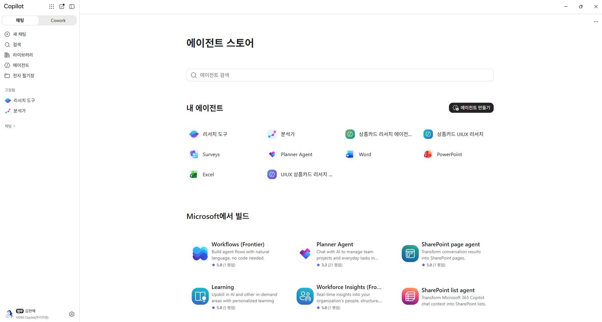
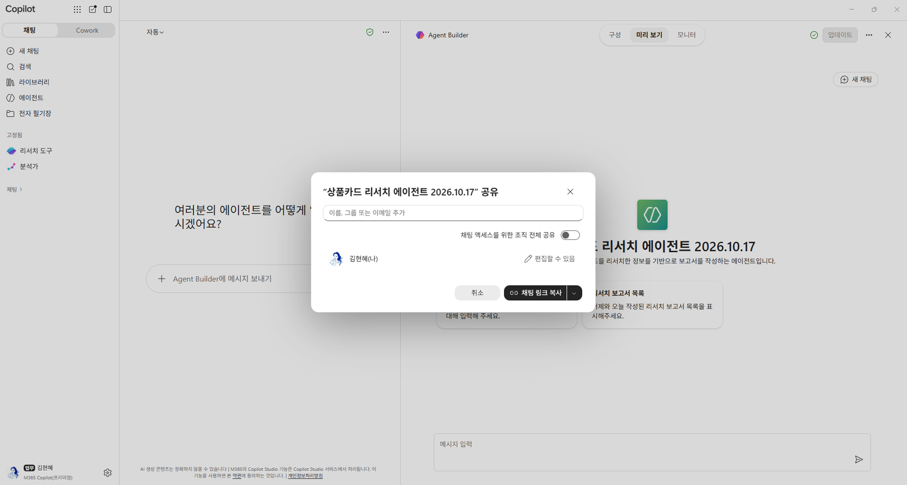

# 09. 참고 자료: Copilot 에이전트

> 에이전트 구성 파일과, 만든 뒤 사용·공유하는 방법입니다.

## 에이전트 구성 파일

| 구분 | 파일 | 사용 위치 |
|---|---|---|
| 안내(Instruction) | [agent/instructions.md](../agent/instructions.md) | Agent Builder `안내` 칸에 붙여넣기 |
| 기술(Skill) | [agent/SKILL.md](../agent/SKILL.md) | 기술 내용 원본 (참고·수정용) |
| 기술 업로드 파일 | [agent/uiux-productcard-research-skill.zip](../agent/uiux-productcard-research-skill.zip) | `기술` > `기술 업로드` (zip만 가능) |

> 기술을 수정하려면 `SKILL.md`를 고친 뒤 다시 zip으로 압축해 업로드하세요.

## 사용·공유 방법

1. `에이전트 스토어` > `내 에이전트`에서 에이전트를 엽니다.
2. 추천 프롬프트 `리서치 보고서 작성` → 경쟁사명·상품을 입력합니다.
3. **[공유]** → 사람 추가 또는 **[채팅 링크 복사]**로 팀에 공유합니다.

| 에이전트 스토어 > 내 에이전트 | 공유 |
|---|---|
|  |  |

---
[← 08. Claude 프로젝트](08-reference-claude.md) · [다음: 10. 실습 후 정리 →](10-cleanup.md)
