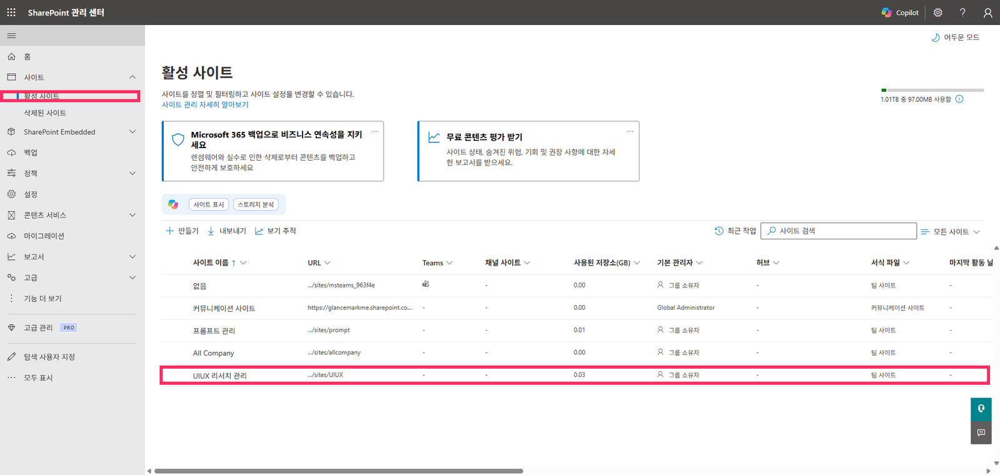
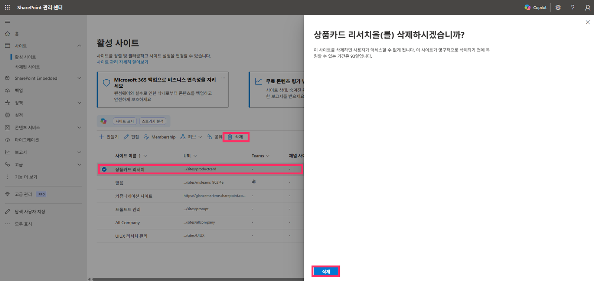
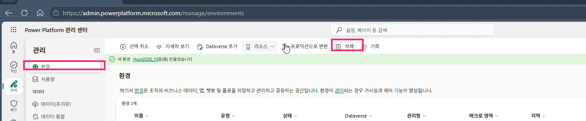
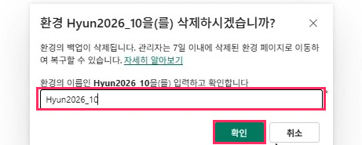
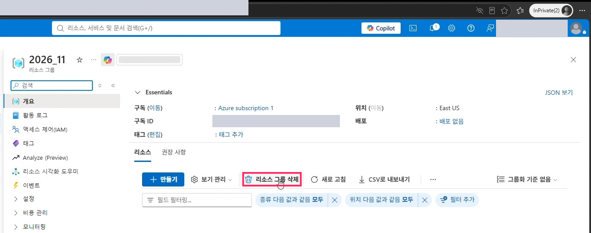
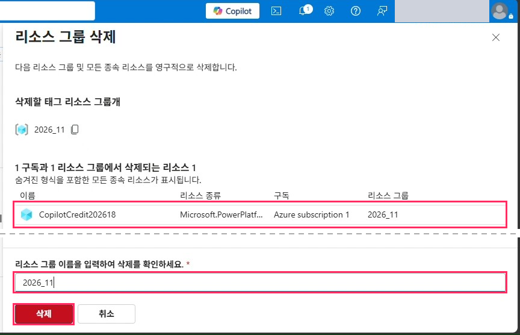
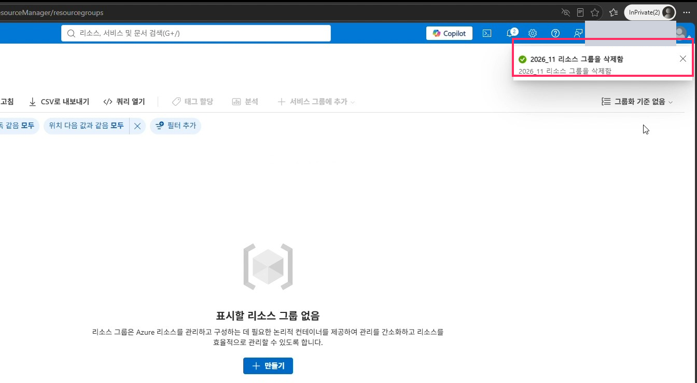

# 10. 실습 후 정리(삭제)

> 권장 순서: **SharePoint 사이트 → Power Platform 환경 → Azure 리소스 그룹**
> 마지막 Azure 리소스 그룹까지 지워야 Copilot Credit 과금이 멈춥니다.

## A. SharePoint 사이트 삭제

1. [admin.sharepoint.com](https://admin.sharepoint.com)에 관리자 계정으로 접속합니다.
2. `사이트` > `활성 사이트`로 이동합니다.
3. 삭제할 사이트를 선택합니다.
4. 상단 **[삭제]**를 클릭합니다.
5. 확인 패널에서 **[삭제]**를 누릅니다.

> 삭제한 사이트는 93일 이내 `삭제된 사이트`에서 복원할 수 있습니다.

## B. Power Platform 환경 삭제

1. [admin.powerplatform.microsoft.com](https://admin.powerplatform.microsoft.com) > `관리` > `환경`으로 이동합니다.
2. 삭제할 환경 행을 선택합니다.
3. 상단 **[삭제]**를 클릭합니다.
4. 환경 이름을 똑같이 입력하고 **[확인]**을 누릅니다.
5. 필요하면 7일 이내 `최근에 삭제된 환경`에서 복구할 수 있습니다.

> 환경을 지우면 그 안의 에이전트와 Dataverse 데이터도 함께 삭제됩니다.

## C. Azure 리소스 그룹 삭제

1. [portal.azure.com](https://portal.azure.com) > `리소스 그룹` > 예) `2026_11`을 엽니다.
2. 개요 상단 **[리소스 그룹 삭제]**를 클릭합니다.
3. 삭제 대상에 청구 플랜 리소스 `CopilotCredit…`가 포함됐는지 확인합니다.
4. 리소스 그룹 이름을 똑같이 입력하고 **[삭제]**를 누릅니다.
5. 알림 `… 리소스 그룹을 삭제함`을 확인합니다. 목록 반영이 늦으면 새로 고침하세요.

| 삭제 확인 | 완료 알림 |
|---|---|
|  |  |

> 삭제 후 Power Platform `라이선싱`의 청구 플랜도 비었는지 확인하세요.

---
[← 09. Copilot 에이전트 사용·공유](09-reference-copilot-agent.md) · [README](../README.md)
